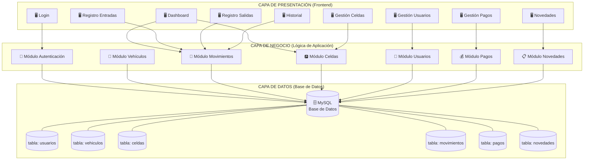
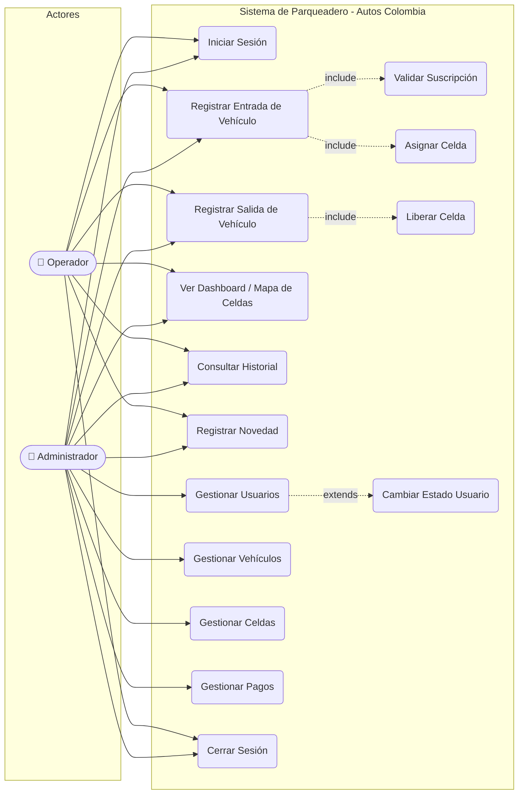
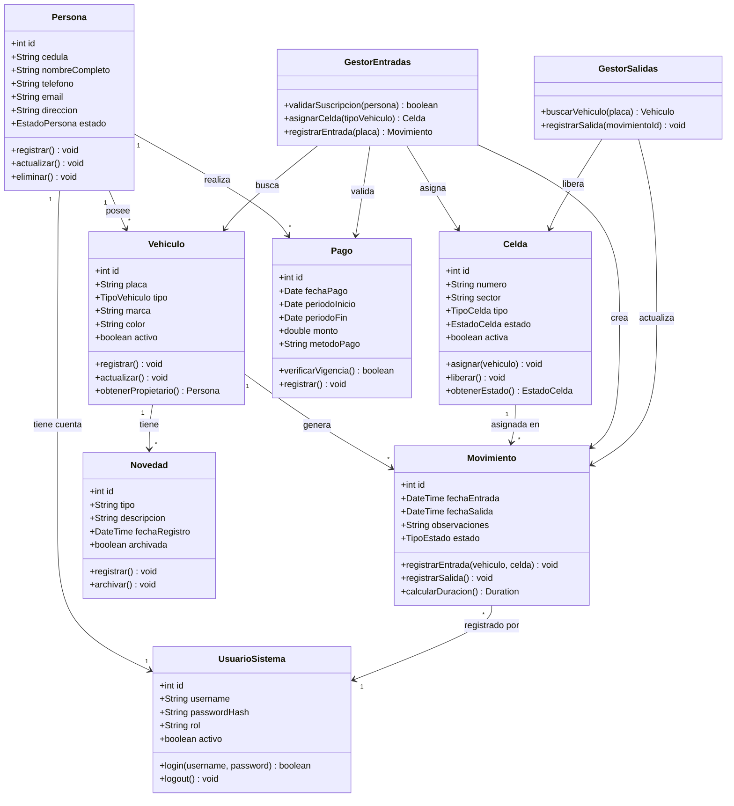
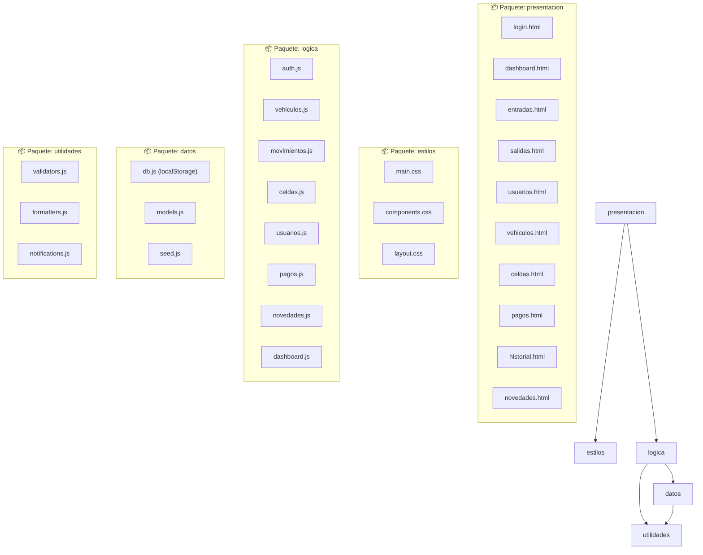
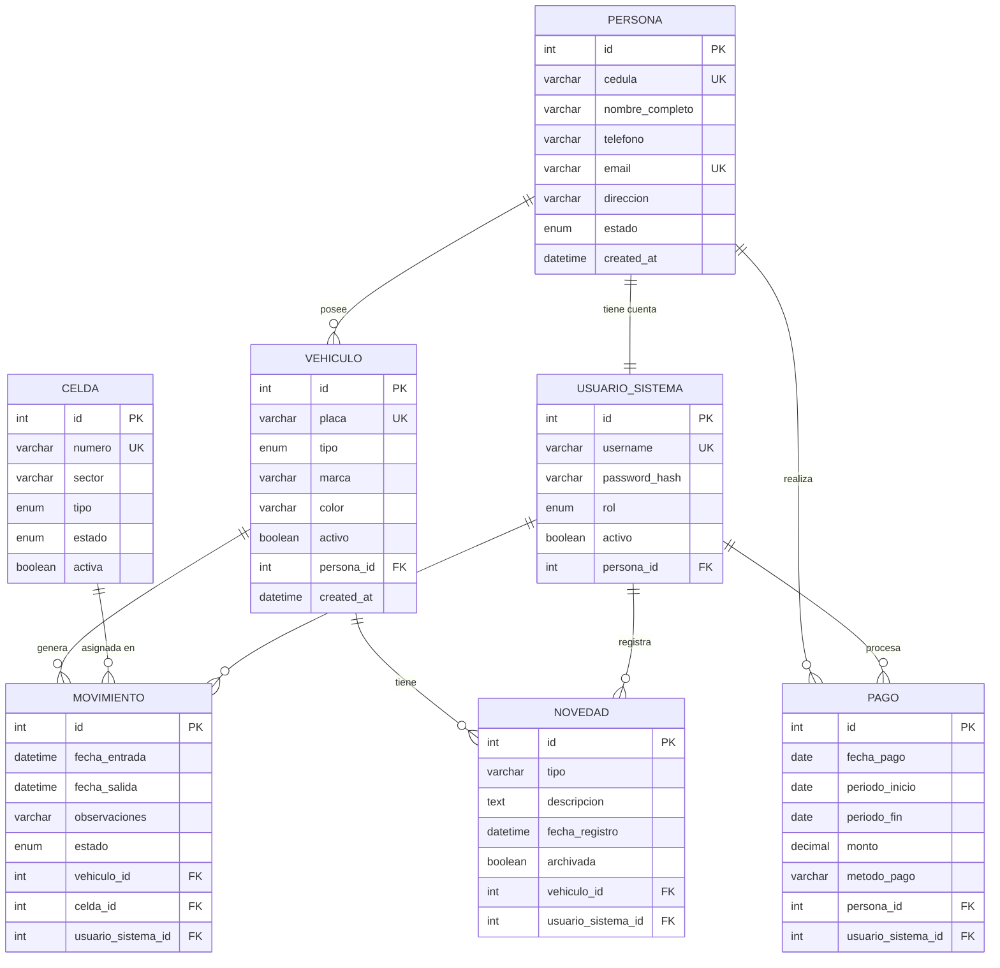

# Diagramas UML – Parqueadero "Autos Colombia"
## Iteración 1

---

## 1. Arquitectura del Sistema (3 Capas)

---

## 2. Diagrama de Casos de Uso

---

## 3. Diagrama de Clases

---

## 4. Diagrama de Paquetes

---

## 5. MER – Modelo Entidad-Relación

